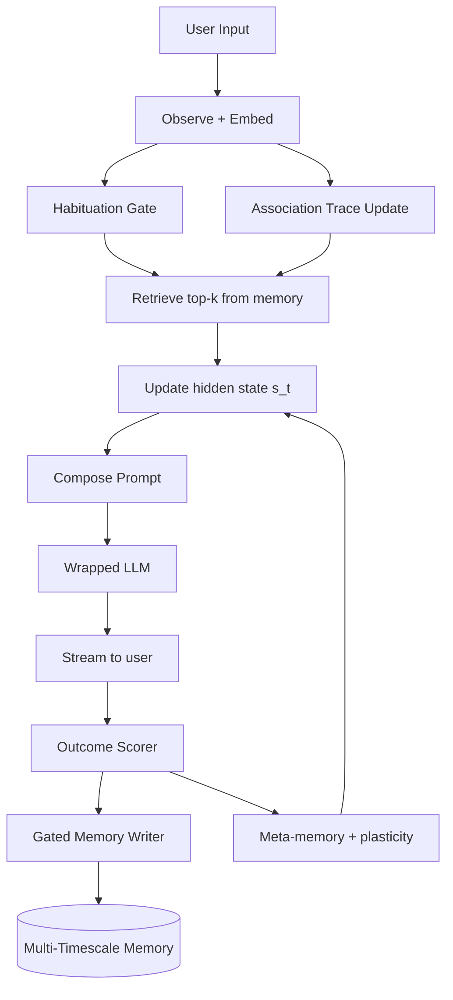

# Living State Machine (LSM)

A local, useful personal AI agent with a Stentor-inspired cognitive wrapper
around a pretrained LLM. Designed for a 16GB-VRAM / 32GB-RAM machine. Phase 1
is a complete product; Phase 2 is an ML research track that trains a small
custom recurrent core whose state update is the Stentor mechanism.

> "Intelligence from compact dynamical rules, not just deeper feedforward
> stacks." — the mental model behind this project.

See `.cursor/plans/plan_8491f6ee.plan.md` for the full build ladder (L0–L15).

---

## What this is

- A local OpenAI-API-compatible server that wraps `qwen2.5:14b-instruct-q4_K_M`
  (or any Ollama model) and adds:
  - a persistent hidden state `s_t` that evolves across turns,
  - episodic + durable memory with CPU-embedded vector search,
  - **habituation** (repeated low-value inputs get damped),
  - **association** (Hebbian co-hit boosts),
  - a **gated memory writer** (store / merge / overwrite / decay / ignore),
  - **multi-timescale memory** (fast, session, durable),
  - an **outcome scoring loop** (self-critic + user feedback),
  - **meta-memory** with plasticity scheduling (trusted entries become slow).
- Ships with a CLI, a FastAPI server, and a ready-to-use Open WebUI front end.
- Ships with its own benchmark suite so research claims are defensible.

## Quick start (Windows)

Toolchain bootstrap (installs Git, Python 3.11, and uv via Scoop; then verifies
official installs of Ollama and Docker Desktop; pulls models; starts Open
WebUI). Run in PowerShell:

```powershell
.\scripts\setup.ps1
```

Start the LSM server (picks up the default model from `.env`):

```powershell
.\scripts\start_server.ps1
```

Open the chat UI in your browser:

```
http://localhost:3000
```

That is Level 1: you already have a fully local personal AI. Everything in
Phase 1 is opt-in additions on top of this baseline.

Run the test suite:

```powershell
uv run pytest
```

Install pre-commit hooks:

```powershell
uv run pre-commit install
```

## Switching models / freeing VRAM

| Command | Effect |
| :-- | :-- |
| `.\scripts\start_server.ps1` | 14B primary model (~11GB VRAM) |
| `.\scripts\start_server.ps1 -Fast` | 7B Q8 fast mode (~7GB VRAM) |
| `uv run lsm serve --stop` | Unload the LSM wrapper |
| `ollama stop qwen2.5:14b-instruct-q4_K_M` | Force Ollama to release the model |

See `memory-bank/techContext.md` for full VRAM accounting.

## Troubleshooting Ollama `HTTP 500`

If `lsm chat` fails with `500 Internal Server Error` from `localhost:11434/api/chat`,
the Ollama daemon rejected the request (often a transient model-load failure on
Windows). LSM retries `500/502/503/504` automatically (up to 3 times); if it
still fails:

1. Restart Ollama (quit from the tray, relaunch).
2. Run `ollama list` to confirm models are present.
3. Free VRAM: `ollama stop <model-tag>` then try the 7B fast model.
4. Re-pull if needed: `ollama pull qwen2.5:7b-instruct-q8_0`.

Full notes: `memory-bank/techContext.md` (Ollama troubleshooting).

## Daily-use CLI

> **Mental model:** `s_t` is a compressed running summary; durable LanceDB
> holds verbatim-ish atoms. For ground truth, use `lsm memory query` (or
> `lsm state show --memories N`).

(Subcommands are introduced as the ladder advances. L0 ships only
`lsm version` and `lsm --help`.)

| Command | Level | Purpose |
| :-- | :-- | :-- |
| `lsm version` | L0 | Version and help |
| `lsm serve [--model X] [--fast] [--stop]` | L2 | Start/stop the API server |
| `lsm chat` | L2 | Interactive REPL against the local server |
| `lsm ingest <path>` | L4 | Ingest files into durable memory |
| `lsm state show` | L3 | Inspect current `s_t` and top memory entries |
| `lsm identity show` / `lsm identity set` | A.6 | View or edit the pinned assistant identity (`identity/role` in `s_t`) |
| `lsm fact list` / `lsm fact show` / `lsm fact prune` | F.1 | Inspect or clean structured facts in `facts.json` |
| `lsm verify "<text>" [--explain]` | V.1 | Score a candidate against live facts + corrections |
| `lsm verify --history N` | V.1 | Show recent verifier gate decisions from `verifier_log.sqlite` |
| `lsm fact category add\|list\|remove` | F.3 | Register dynamic `user.*` categories |
| `lsm fact set --category … --value …` | F.3 | Manually upsert a fact (incl. custom categories) |
| `lsm note add` / `list` / `clear` | F.2 | Manage `assistant.notes` facts |
| `lsm memory query "<text>"` | L4 | Manually query memory |
| `lsm memory purge --older-than 90d` | L8 | Clean up durable memory |
| `lsm snapshot create --tag <name>` | L3 | Snapshot state to a safe point |
| `lsm snapshot restore --tag <name>` | L3 | Roll back |
| `lsm eval run --config <yaml>` | L4+ | Run a benchmark with configured ablations |
| `lsm train small --config <yaml>` | L11+ | Phase 2 training runs |

## Architecture at a glance



Full design: `memory-bank/systemPatterns.md` and `docs/architecture.md`.

## Repository layout

```
living-state-machine/
  memory-bank/              # project memory (project brief, patterns, etc.)
  docs/                     # hypotheses, architecture, privacy, negative results
  lsm/
    core/                   # state, memory, habituation, association, writer, scorer, meta
    runtime/                # LLM backends (ollama, transformers), prompt compose
    serve/                  # FastAPI OpenAI-compatible server
    cli/                    # typer CLI
    eval/                   # runner, tasks/, baselines/, metrics
    research/               # phase 2: small_core/, training/
  experiments/              # per-run configs + results (gitignored bodies)
  scripts/                  # setup.ps1, start_server.ps1, reproduce_*.ps1
  tests/
  models/                   # downloaded weights (gitignored)
  data/                     # corpora (gitignored)
```

## Research track

This project produces **measured** results, not vibes. Every new mechanism
lands with:

- a hypothesis in `docs/hypotheses.md`,
- a matched baseline,
- an ablation flag that disables the mechanism,
- at least 3 seeds,
- a YAML config copied into the run directory.

See `memory-bank/systemPatterns.md` and `docs/architecture.md`. The full
rigor protocol is section 6 of the plan.

## Privacy

All data stays local. Durable memory is encrypted at rest with Fernet by
default. No telemetry. See `docs/privacy.md`.

## License

MIT. See `LICENSE`.

## Credits

- Stentor paper: *Associative learning in the protozoan Stentor coeruleus*
  (bioRxiv, 2026).
- Qwen2.5, Llama 3.1, Ollama, Open WebUI, LanceDB, fastembed, FastAPI.

---

Built by reishi, with Gee.
