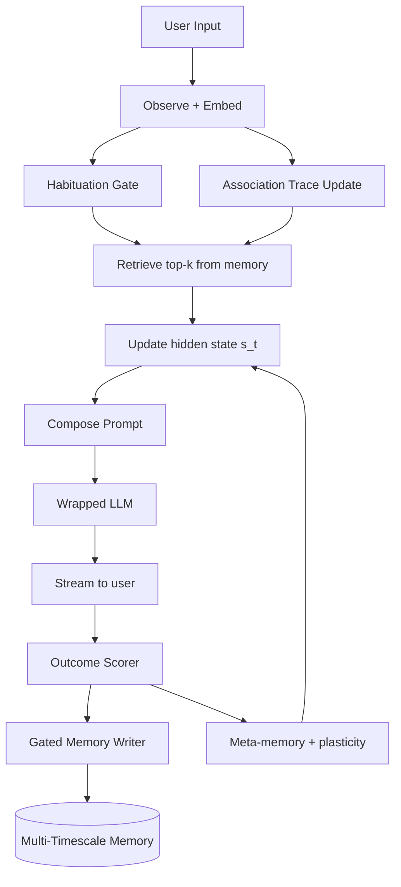

# Living State Machine (LSM)

A local personal AI that wraps an Ollama model with memory dynamics inspired
by *Stentor coeruleus*: habituation, association, gated writes, multi-timescale
storage, and a running hidden state `s_t`. Built for a 16GB VRAM / 32GB RAM
Windows box.

The research track is closed (2026-07-15). What remains is daily use and
optional polish. Headline write-up: [`docs/paper_abstract.md`](docs/paper_abstract.md).
Build ladder (L0–L15): `.cursor/plans/plan_8491f6ee.plan.md`.

---

## Research status

| Phase | Exit doc | Result |
| --- | --- | --- |
| 1. Wrapper (L0–L10) | [`docs/phase1_exit.md`](docs/phase1_exit.md) | On matched-budget `recall_pref_v1`, LSM scored 1.000 vs naive RAG 0.100 |
| 2. Small SSM + hybrid + QLoRA | [`docs/phase2_exit.md`](docs/phase2_exit.md) | Hybrid and adapter arms kept 1.000 on v1. Stentor-in-SSM lost to a minimal SSM on TinyStories LM loss |

Negatives and stress benches: [`docs/negative_results.md`](docs/negative_results.md),
[`docs/recall_pref_v2_findings.md`](docs/recall_pref_v2_findings.md).

For a portfolio link, the repo plus the abstract is enough. If you ever want
arXiv or a workshop, the parked checklist is
[`docs/higher_bar_plan.md`](docs/higher_bar_plan.md). Peer review is optional,
not a missing exit gate.

---

## What runs

OpenAI-compatible FastAPI in front of Ollama (Transformers path for research).
Each turn can:

1. retrieve from LanceDB with habituation / association / trust scoring
2. inject `s_t` and structured facts into the prompt
3. stream a reply
4. score the outcome and decide whether to write durable memory

You get a CLI (`lsm chat`, `lsm serve`), the API on port 8765, and optional
Open WebUI. Eval lives under `lsm/eval/` with YAML configs in `experiments/`.

Default model tags live in `.env` (see `.env.example`). Daily chat often uses
`qwen3.5:9b`; `-Fast` loads `qwen3.5:4b`.

---

## Quick start (Windows)

PowerShell:

```powershell
.\scripts\setup.ps1
.\scripts\start_server.ps1
```

Chat UI (if Open WebUI is up): http://localhost:3000
API health: http://127.0.0.1:8765/health
REPL: `uv run lsm chat`

```powershell
uv run pytest
uv run pre-commit install
```

### Models and VRAM

| Command | Effect |
| --- | --- |
| `.\scripts\start_server.ps1` | Default from `.env` (`LSM_MODEL`) |
| `.\scripts\start_server.ps1 -Fast` | `qwen3.5:4b` |
| `uv run lsm serve --stop` | Stop the LSM server |
| `ollama stop <tag>` | Unload that Ollama model |

VRAM notes: `memory-bank/techContext.md`.

### Ollama HTTP 500

`lsm chat` talking to `localhost:11434` sometimes gets a transient 500 on
Windows while the model loads. LSM retries 500/502/503/504 up to three times.
If it still fails: restart Ollama from the tray, check `ollama list`, free VRAM
with `ollama stop <tag>`, or pull the fast model again.

---

## Daily CLI

`s_t` is a compressed summary. LanceDB holds longer-lived rows. For ground
truth, prefer `lsm memory query` or `lsm state show --memories N`.

| Command | Purpose |
| --- | --- |
| `lsm version` | Version |
| `lsm serve [--model X] [--fast] [--stop]` | API server |
| `lsm chat` | Interactive REPL |
| `lsm ingest <path>` | Ingest files into durable memory |
| `lsm state show` | Inspect `s_t` |
| `lsm identity show` / `set` | Pinned assistant identity |
| `lsm fact list` / `show` / `prune` / `set` | Structured facts |
| `lsm verify "<text>" [--explain]` | Score a candidate against live facts |
| `lsm memory query "<text>"` | Query durable memory |
| `lsm memory purge --older-than 90d` | Age out old durable rows |
| `lsm snapshot create\|restore --tag <name>` | Checkpoint / roll back state |
| `lsm eval run --config <yaml>` | Benchmark run |
| `lsm train small --config <yaml>` | Phase 2 training |

---

## Pipeline sketch



Design notes: `memory-bank/systemPatterns.md`, `docs/architecture.md`.

---

## Repo layout

```
living-state-machine/
  memory-bank/     project brief, patterns, progress
  docs/            exits, reports, hypotheses, negatives, privacy
  lsm/
    core/          state, memory, habituation, association, writer, verifier
    runtime/       backends, prompt compose, pipeline factory
    serve/         FastAPI
    cli/           typer CLI
    eval/          tasks, baselines, runner
    research/      small_core, training, hybrid
  experiments/     YAML configs; run bodies mostly gitignored
  scripts/         setup, server, suite drivers
  tests/
  models/          downloaded weights (gitignored)
  data/            corpora (gitignored)
```

---

## How claims were checked

New mechanisms were supposed to land with a hypothesis in
`docs/hypotheses.md`, a baseline, an ablation flag, multi-seed runs where we
claimed them, and a YAML copied into the run dir. We did not always hit three
seeds on Phase 2 (seed 0 only there). That limit is written into the exit docs
instead of papered over.

---

## Privacy

Everything stays on the machine. No product telemetry. Outbound traffic is the
local Ollama daemon, Hugging Face downloads when you pull models, and optional
Weights & Biases if you turn it on for training.

Durable memory can use Fernet at rest when `LSM_ENCRYPT=true` (see
`docs/privacy.md`). That path exists; it is not a full security audit. Treat
`$LSM_HOME` like any other local personal data.

---

## License

MIT. See `LICENSE`.

## Credits

- Stentor paper: *Associative learning in the protozoan Stentor coeruleus*
  (bioRxiv, 2026)
- Qwen, Ollama, Open WebUI, LanceDB, fastembed, FastAPI
