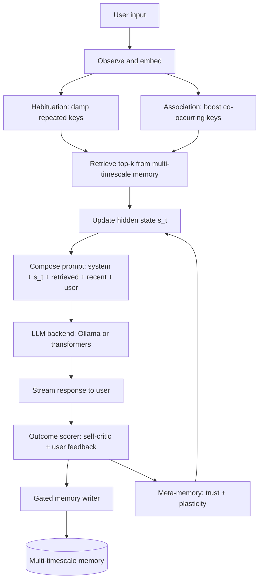

# Architecture

This document is the engineering-facing companion to
`memory-bank/systemPatterns.md`. For high-level design, read that first.

## Per-turn control loop

## Component protocols

See `lsm/core/protocols.py` (introduced in L4). Every Stentor mechanism
implements a small Protocol; a `Null*` implementation exists for ablations.

## Memory tiers

| Tier | Location | Decay constant | Typical lifetime |
| :-- | :-- | :-- | :-- |
| Fast | in-prompt scratchpad | `tau_fast` (minutes) | a few turns |
| Session | RAM dict, flushed on reload | `tau_session` (hours) | a session |
| Durable | LanceDB + SQLite on disk | `tau_durable` (months) | forever-ish |

Promotion rules are in `lsm/core/memory.py`:
- Fast -> Session on a hit that was not habituated.
- Session -> Durable on outcome confirmation (positive reward + writer accept).
- Durable entries can be decayed by the background consolidator but not deleted
  without the user's explicit ingest-delete call.

## State representation

`s_t` has two synced views: a compact text summary (the LLM reads this in the
system prompt) and a 384-d CPU-embedded vector (used for retrieval
conditioning and, in Phase 2, as the recurrent core's external input).

Update rules:
- L3: LLM-written summary (cheap, expressive, but model-dependent).
- L14: custom small recurrent core's final state is the vector; the text is
  produced by a tiny decoder head or by continuing to use the LLM summarizer.

## Ablation matrix

See `lsm/eval/runner.py`. For each component ∈ {habituation, association,
writer, multi-timescale, scorer, meta}, the runner supports toggling it off by
swapping in the `Null*` implementation.
